# Architecture

This document describes how the Smart Clinic Management System is built, how a request moves through it,
and where the design is strong or needs work. For endpoint details see [API.md](API.md). For column-level
schema see [schema-design.md](../schema-design.md).

## Contents

1. [System overview](#1-system-overview)
2. [Layered architecture](#2-layered-architecture)
3. [Domain model](#3-domain-model)
4. [Class diagrams](#4-class-diagrams)
5. [Key request flows](#5-key-request-flows)
6. [Security model](#6-security-model)
7. [Persistence](#7-persistence)
8. [Error handling](#8-error-handling)
9. [Frontend](#9-frontend)
10. [Deployment and CI](#10-deployment-and-ci)

---

## 1. System overview

The system is a **monolithic Spring Boot application** that follows a classic **three-tier architecture**. One
deployable JAR serves the static frontend, renders two server-side pages and exposes a REST API. Data is split
across two databases by its shape:

- **MySQL** holds the relational core: admins, doctors, patients and appointments, where foreign keys and
  uniqueness matter.
- **MongoDB** holds prescriptions: semi-structured documents with an embedded pharmacy that are only read
  per appointment.

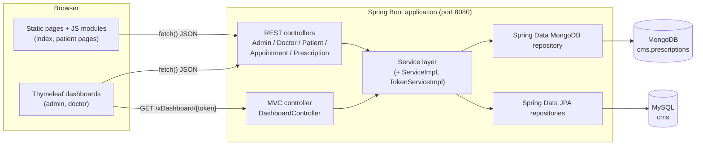

---

## 2. Layered architecture

| Tier | Package / location | Responsibility |
|---|---|---|
| **Presentation** | `resources/static`, `resources/templates` | HTML/CSS/JS. Calls the API with `fetch`. Stores the JWT and role in `localStorage`. |
| **Web** | `mvc`, `controllers` | Map HTTP to Java: parse path variables and bodies, run Bean Validation (`@Valid`), validate the token's role, shape the JSON (`{"message"}`, `{"doctors": [...]}`...). |
| **Service** | `services`, `services.impl` | Business rules: slot availability, ownership checks, status transitions, duplicate detection, filtering. |
| **Persistence** | `repo`, `models` | Spring Data repositories (derived queries and JPQL `@Query`), JPA entities and Mongo documents. |
| **Cross-cutting** | `Exception`, `config`, `DTO` | Exception handling, JWT filter, CORS, transfer objects. |

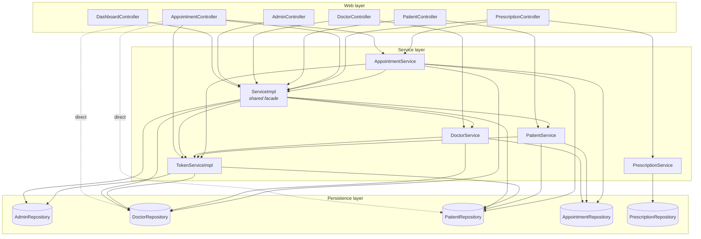

The dotted arrows mark the places where a controller skips the service layer (see
[§11](#11-architecture-assessment)).

### The `ServiceImpl` facade

`ServiceImpl` collects logic that more than one controller needs:

| Method | Used by | Purpose |
|---|---|---|
| `validateToken(token, role)` | every protected endpoint | Returns `200` or `401 {"message"}` so controllers can return it as is |
| `validateAdmin(username, pwd)` | AdminController | Admin login, issues a JWT |
| `validatePatientLogin(login)` | PatientController | Patient login, issues a JWT |
| `validatePatient(email, phone)` | PatientController | `true` if neither the email nor the phone is registered |
| `validateAppointment(dto)` | AppointmentService | `1` slot free, `0` slot taken, `-1` unknown doctor |
| `filterDoctor(name, time, speciality)` | DoctorController | Name/speciality filter plus AM/PM availability filter |
| `filterPatient(token, doctorName, condition)` | PatientController | Resolves the patient from the token, then picks the right filter |

---

## 3. Domain model

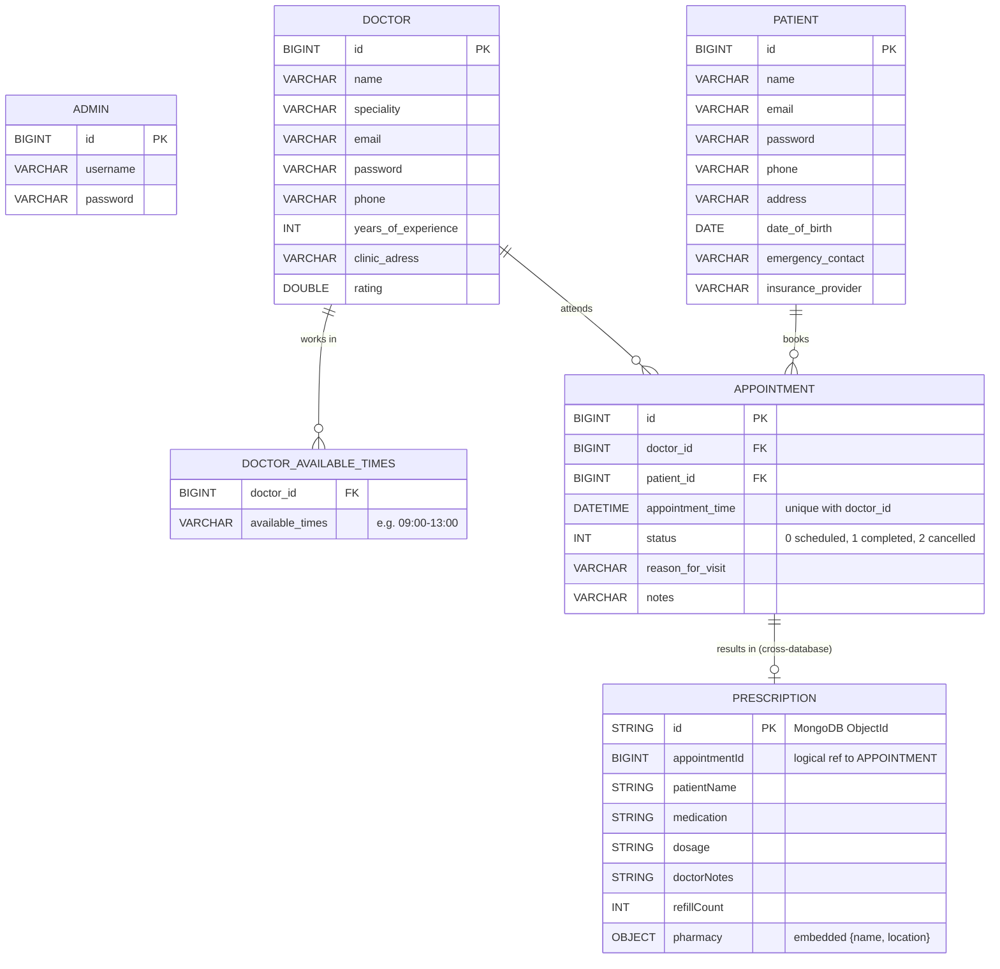

Key rules that live in the model:

- **One appointment per doctor and time slot.** This is enforced by the unique constraint
  `uk_appointment_doctor_time (doctor_id, appointment_time)`. It is the last line of defence against two patients
  booking the same slot at the same time.
- **Appointments last one hour.** `endTime`, `appointmentDate` and `appointmentTimeOnly` are derived `@Transient`
  getters and are not stored.
- **Availability is a set of ranges.** `availableTimes` stores ranges like `09:00-13:00`. The service splits them
  into 1-hour slots and removes the ones already booked.
- **Prescription to appointment is a logical link.** `appointmentId` is a plain number in MongoDB, so no
  database enforces it.

---

## 4. Class diagrams

### 4.1 Domain model and DTOs

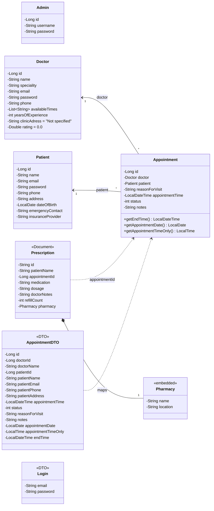

### 4.2 Service layer

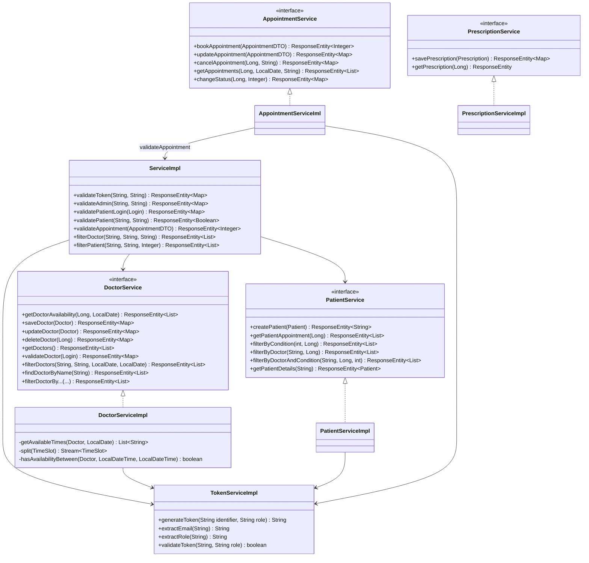

### 4.3 Web layer and repositories

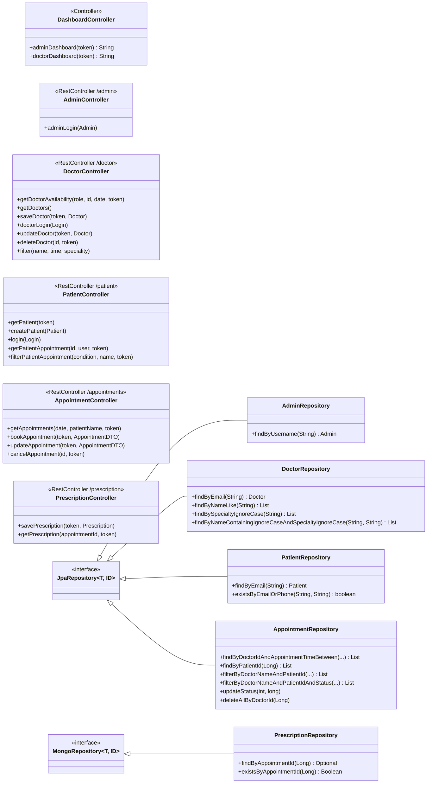

---

## 5. Key request flows

### 5.1 Admin login and dashboard

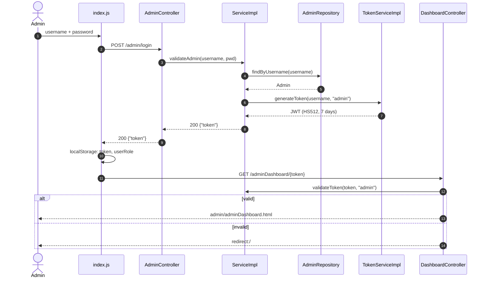

Doctor and patient logins follow the same pattern. They differ in the repository used and in where the user lands
(the doctor dashboard, or `loggedPatientDashboard.html`).

### 5.2 Booking an appointment

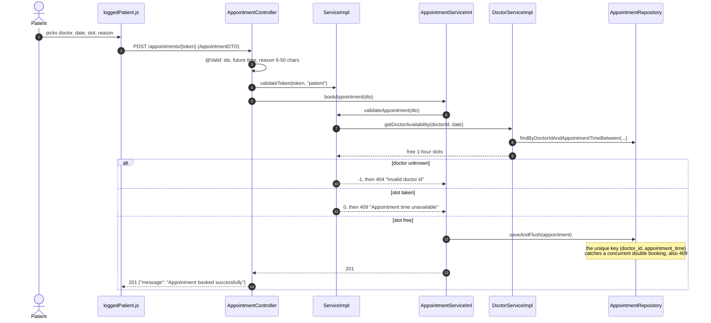

### 5.3 Writing a prescription (spans both databases)

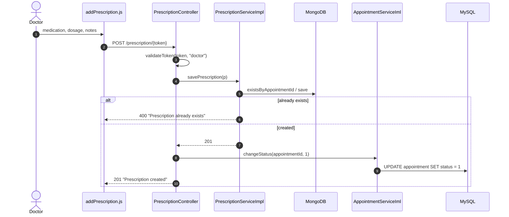

The two writes are **not atomic**. If the MySQL update fails after the MongoDB insert, the prescription exists but the
appointment stays as scheduled. See the assessment below.

---

## 6. Security model

| Aspect | Implementation |
|---|---|
| Token | JWT signed with HS512 (`jwt.secret`, at least 64 bytes). `sub` = email or username, `role` claim, 7-day expiry. |
| Transport of the token | Last segment of the URL path (`/appointments/{token}`). The frontend keeps it in `localStorage`. |
| Authorization | Each protected endpoint calls `ServiceImpl.validateToken(token, role)`, which checks the signature, the expiry, the role claim, and that the user still exists. |
| Ownership | Patients can only read, update or cancel their own appointments. The patient is resolved from the token and compared with the resource. |
| Passwords | Write-only in JSON (`@JsonProperty(WRITE_ONLY)`). **Stored and compared in plain text.** |
| CORS | `WebConfig` allows every origin (`*`) for GET, POST, PUT and DELETE. |
| `JwtAuthenticationFilter` | Validates an `Authorization: Bearer` header if present and exposes the identity as request attributes. The frontend never sends that header, so in practice this filter is not used. |

There is no Spring Security. Authorization is done by hand in each controller method.

---

## 7. Persistence

| Concern | Choice |
|---|---|
| Schema management | `spring.jpa.hibernate.ddl-auto=update`: Hibernate creates and alters the tables. There are no migration scripts. |
| Validation | Bean Validation on entities and DTOs. It runs at the HTTP boundary (`@Valid`) **and** again when Hibernate persists. |
| Transactions | `@Transactional` on service methods. Writes that must report DB errors use `saveAndFlush` / `flush()` inside a `try`, so the exception is raised while it can still be caught. |
| Defaults | `Doctor.rating = 0.0`, `Doctor.clinicAdress` and `Prescription.pharmacy = "Not specified"` (`@Builder.Default`), so that entities are valid even when the frontend omits these fields. |
| Open session in view | Disabled (`spring.jpa.open-in-view=false`). Data is mapped to DTOs inside the transaction. |
| MongoDB | One collection, `prescriptions`, accessed through `MongoRepository`. `Pharmacy` is embedded. |

---

## 8. Error handling

Every error the frontend can display uses the key **`message`**.

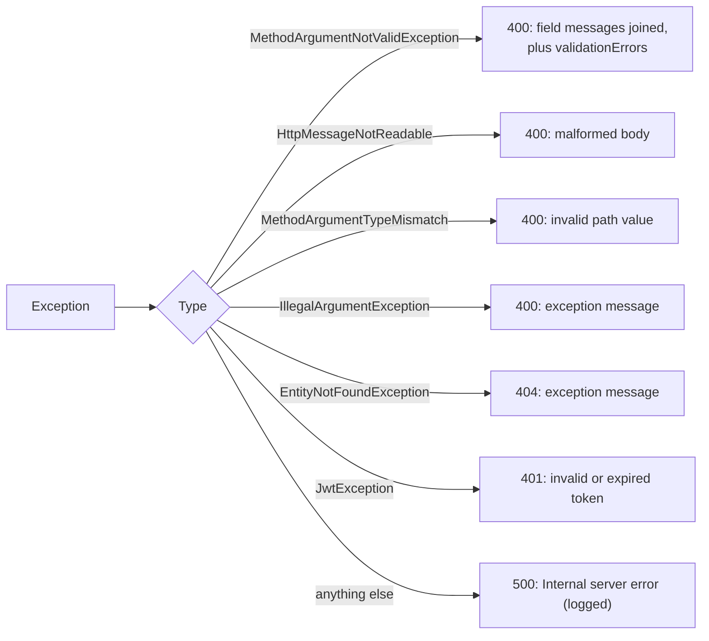

Handled by `GlobalExceptionHandler`, which returns `ErrorResponse {timestamp, status, message, validationErrors}`.
Business outcomes such as "slot taken" or "already exists" are not exceptions. Services return them as
`ResponseEntity` values with the matching status code.

---

## 9. Frontend

| Page | Served as | Script | Talks to |
|---|---|---|---|
| `index.html` (role selection and logins) | static | `services/index.js`, `render.js` | `/admin/login`, `/doctor/login` |
| `templates/admin/adminDashboard.html` | Thymeleaf | `adminDashboard.js`, `doctorCard.js` | `/doctor/**` |
| `templates/doctor/doctorDashboard.html` | Thymeleaf | `doctorDashboard.js`, `patientRows.js` | `/appointments/{date}/...` |
| `pages/patientDashboard.html` (anonymous) | static | `patientDashboard.js` | `/doctor`, `/patient`, `/patient/login` |
| `pages/loggedPatientDashboard.html` | static | `loggedPatient.js` | `/doctor/**`, `/patient/{token}`, `POST /appointments/{token}` |
| `pages/patientAppointments.html` | static | `patientAppointment.js` | `/patient/{id}/patient/{token}`, `/patient/filter/...` |
| `pages/updateAppointment.html` | static | `updateAppointment.js` | `PUT /appointments/{token}` |
| `pages/patientRecord.html` | static | `patientRecordServices.js` | `/patient/{id}/doctor/{token}` |
| `pages/addPrescription.html` | static | `addPrescription.js` | `/prescription/**` |

The frontend uses native ES modules with no bundler. HTML that relies on inline handlers (`onclick="openModal()"`)
needs those functions on `window`. The modules that own them assign them explicitly (for example
`window.openModal`, `window.showBookingOverlay`).

---

## 10. Deployment and CI

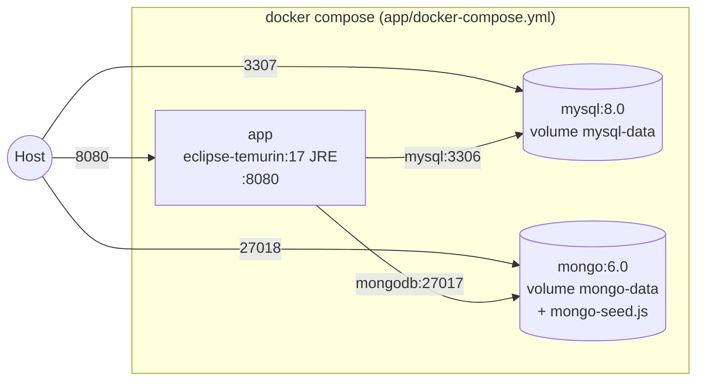

- **Image.** A multi-stage Dockerfile builds with `maven:3.9.9-eclipse-temurin-17` and runs on
  `eclipse-temurin:17.0.15_6-jre`. Only the JAR goes into the runtime image.
- **Startup order.** The app waits for both databases to pass their healthchecks (`depends_on: service_healthy`).
- **Configuration.** Twelve-factor style: everything comes from environment variables (`.env` plus `environment:`
  overrides in Compose).

CI (GitHub Actions, on every push and PR):

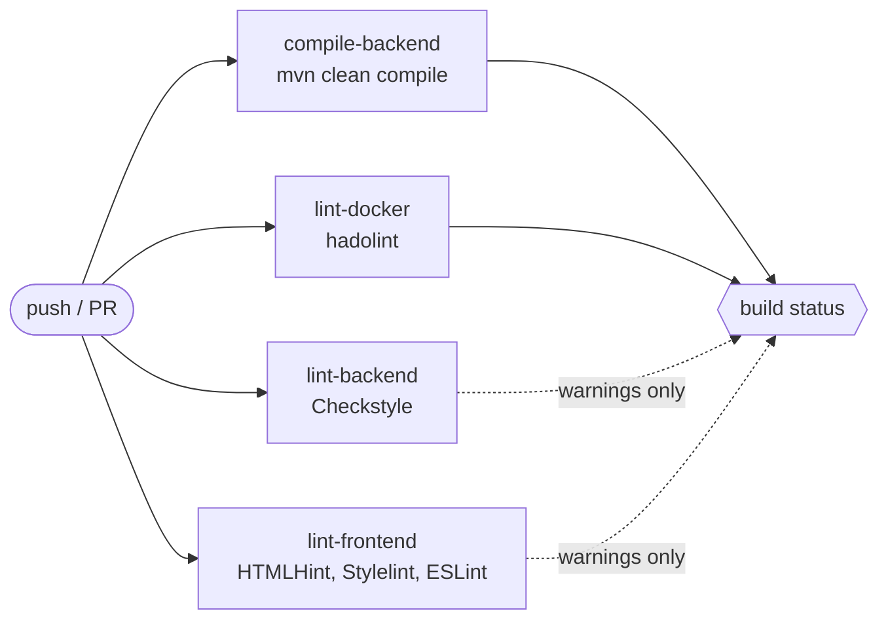